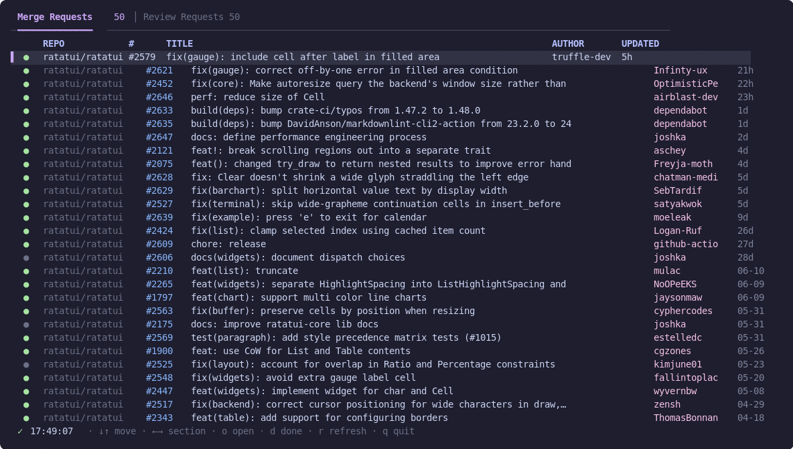

# ghbox

A TUI that keeps the PRs where the ball is in your court on screen — and lets you act on them.

ghbox lists merge requests — comments that contain both an `@mention` of you and a
merge keyword *in the same comment* — plus review requests (`review-requested:@me`),
grouped by repository, with done-state tracking. GitHub search cannot express the
same-comment condition (`mentions:@me` and `in:comments` each match anywhere in the
PR), so ghbox fetches comment bodies and filters locally. Merge-keyword matching is
bilingual out of the box: `(?i)(merge|マージ)`.



## Install

```sh
cargo install --path crates/ghbox
```

Authentication uses `gh auth token`. Run `gh auth login` beforehand.

## Usage

```sh
ghbox
```

| Key | Action |
|---|---|
| ↓ / j | Move down |
| ↑ / k | Move up |
| → / l | Next section |
| ← / h | Previous section |
| o | Open PR in browser |
| d | Mark as done |
| r | Manual refresh |
| q | Quit |

Keys can be remapped under `[keybindings]` (assign multiple keys to one action with an array).

## Config

`$XDG_CONFIG_HOME/ghbox/config.toml` (without one, two built-in default sections are used: merge requests + review requests):

Each section needs at least one of `query` (a GitHub search string) or `repos`
(`["owner/name", ...]`, enumerating those repos' open PRs directly); both together
union the results, deduped by PR. `repos` is immune to GitHub search-index lag —
recommended for "ball is in your court" sections over repos you already know, while
`query` stays useful for broader discovery.

`repos` enumeration only picks up PRs updated within the last 30 days by
default; tune per section with `repos_updated_within_days` (`0` = unlimited).

```toml
poll_interval_secs = 300            # polling interval in seconds (min 30)
db_path = "/nas/ghbox/state.db"     # done-state DB. Default: $XDG_DATA_HOME/ghbox/state.db

[[sections]]
title = "Merge Requests"
query = "is:pr is:open mentions:@me"
columns = ["repo", "number", "title", "author", "comment", "updated"]
# include_own = true also surfaces your own matching comments (memos to self)
filter = { type = "comment-mention", extra_patterns = ["(?i)ship\\s*it"], include_own = true }
# omit sort = "updated" (PR last update). "created" sorts by comment/PR creation instead
sort = "created"

[[sections]]
title = "Review Requests"
query = "is:pr is:open review-requested:@me"
# omit filter = keep search results as-is. omit columns = ["state", "repo", "number", "title", "author", "updated"]

[[sections]]
title = "Merge Requests (big-repo)"
repos = ["myorg/big-repo"]           # direct enumeration instead of query — no index lag
repos_updated_within_days = 30       # default 30; 0 = unlimited. repos sources only
filter = { type = "comment-mention" }

[[sections]]
title = "Review Requests (big-repo)"
repos = ["myorg/big-repo"]
# keeps PRs where you're still a requested *user* reviewer. Team review requests
# aren't matched — use a query source with review-requested:@me if you rely on those
filter = { type = "review-requested" }

[[sections]]
title = "PRs involving me"
query = "is:pr is:open involves:@me"
# external command filter: receives one JSON object per line on stdin (each with an
# id field), prints the ids to keep on stdout, one per line. 10s timeout
filter = { type = "command", command = "jq -r 'select(.pr_author != \"nogu3\") | .id'" }

icons = true                        # default state icons require a Nerd Font. Set false for ● fallback

[theme]                             # omitted keys use defaults (catppuccin mocha). ratatui named colors (lowercase) or "#rrggbb"
tab_active = "#cba6f7"              # accent color: active tab, tab underline, selection marker, spinner
selection_bg = "#313244"
pr_number = "#89b4fa"               # PR number column. author / time / faint column colors also configurable
state_open = "#a6e3a1"              # state column icon color: state_draft / state_merged / state_closed too

[keybindings]                       # omitted keys use defaults. Values: a single char/tab/backtab/enter/up/down/left/right/esc, or an array
quit = "q"
done = "d"
next_section = ["right", "l"]       # assign multiple keys with an array
```

## Development

```sh
cargo run -p ghbox          # launch the TUI
cargo test --workspace
cargo clippy --workspace -- -D warnings
cargo fmt --all
```

## License

MIT
